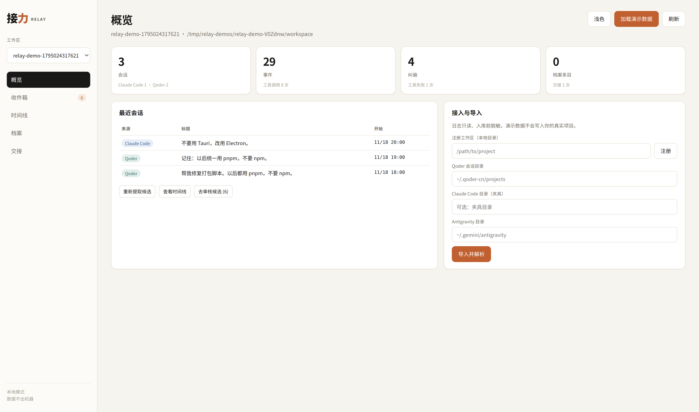
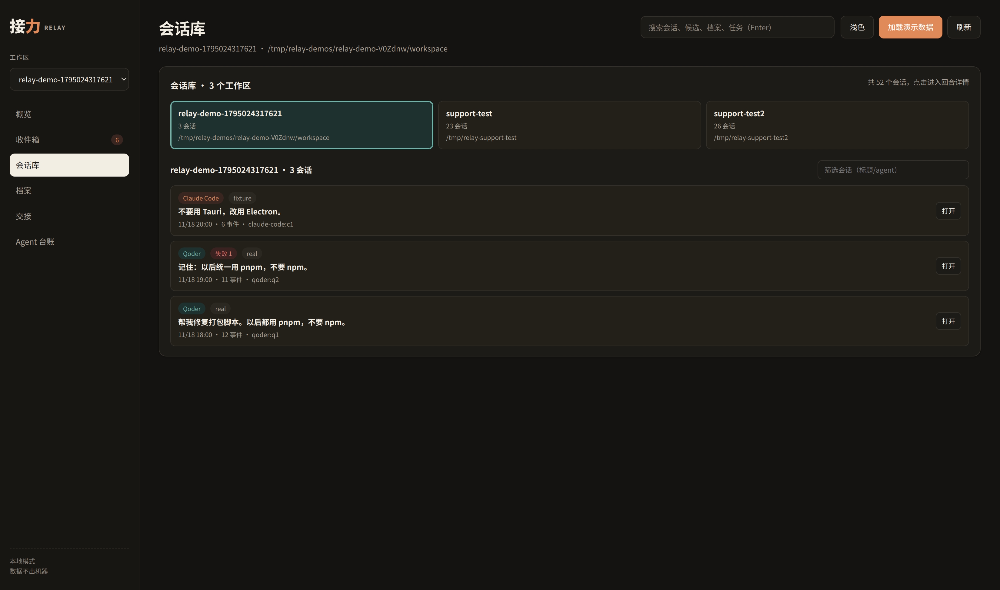
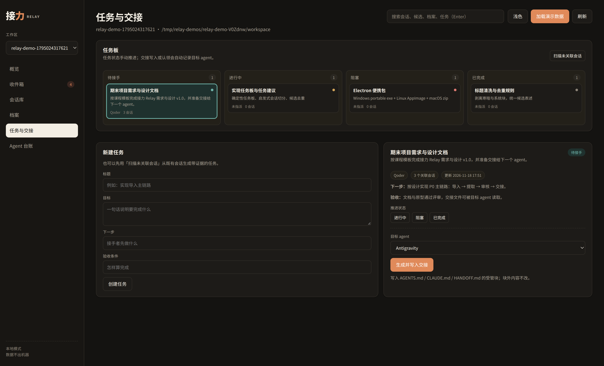
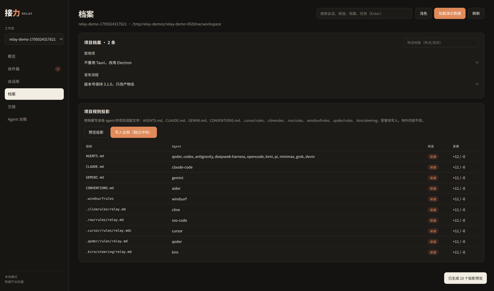
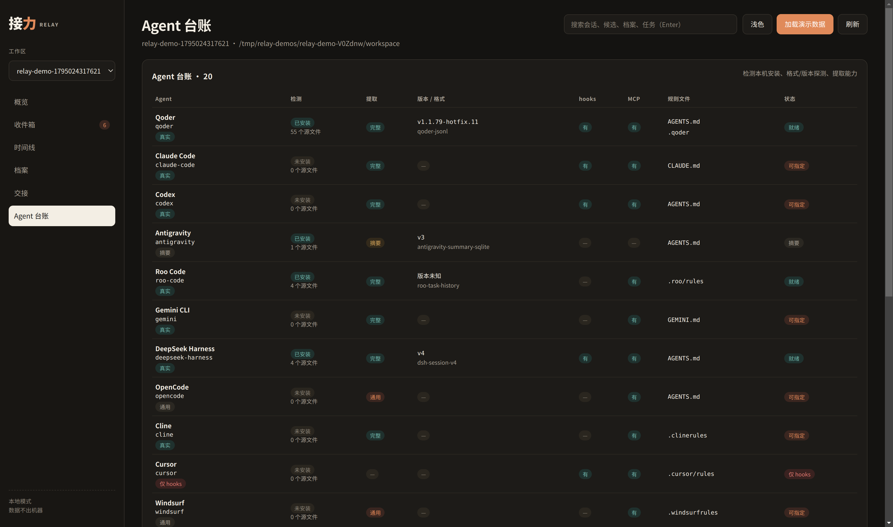

# 接力 Relay

> **跨 Agent 的本地记忆与交接工作台**  
> 换 Agent，不换上下文。读取各家 coding agent 的本地会话，把习惯、环境与任务上下文固化成可审核、可版本化的交接档案，让下一个 agent 换班即读。

软件工程课程期末项目 · v0.3.0 · 2026-11



## 下载便携版

从 [Releases](https://github.com/Zhyuan0001/relay/releases/latest) 下载：

| 平台 | 文件 | 形态 | 数据位置 |
|---|---|---|---|
| Windows x64 | `Relay-0.3.0-windows-portable-x64.exe` | 单文件便携 exe，免安装 | exe 同目录 `RelayData/relay.db` |
| Linux x64 | `Relay-0.3.0-linux-x86_64.AppImage` | 单文件 AppImage | `~/.config/Relay/relay.db` |
| Linux x64 | `Relay-0.3.0-linux-x64.tar.gz` | 解压即用目录 | `~/.config/Relay/relay.db` |
| macOS Intel / Apple Silicon | `Relay-0.3.0-mac-x64.zip` / `Relay-0.3.0-mac-arm64.zip` | 解压得到 `.app` | `~/Library/Application Support/Relay/relay.db` |

> macOS 包未签名/未公证。首次打开若被 Gatekeeper 拦截，右键 `.app` → 打开；或执行 `xattr -dr com.apple.quarantine /Applications/Relay.app`。正式对外分发需要 Apple Developer ID 签名与公证。

> Linux AppImage 需要 FUSE；没有 FUSE 时可用 `./Relay-*.AppImage --appimage-extract-and-run`。构建基线为 Ubuntu 22.04 / glibc 2.35。

## 当前状态

| 项目 | 状态 |
|---|---|
| 核心链路 | 导入 → 去重 → 纠偏/经验提取 → 人工审核 → 档案版本 → 任务板 → 交接简报 → 受管块写入 → claim-once |
| 自动化 | 自动发现工作区、按 cwd 路由、文件游标增量导入、watcher、自动提炼、自动认领、10 个项目规则投影 |
| 任务板 | 待接手 / 进行中 / 阻塞 / 已完成四列；启发式任务建议；候选确定性去重；交接/认领自动记录 owner |
| Harness | 目录覆盖 20 个；18 个本地 harness 有适配器（9 具体 + 9 通用）；Cursor 仅 hooks；Devin 云端-only |
| 界面 | 六视图、工作区分组会话库、会话详情抽屉、亮/暗、1100/900/680 响应式、全局搜索 |
| 测试 | 25/25 通过（`npm test`） |
| 桌面 | Electron 45 内置 Node 24.22 + `node:sqlite`，不依赖系统 Node；Windows / Linux / macOS 构建由 GitHub Actions 产出 |

## 三条功能主线

1. **统计与浏览**：工作区、会话、事件、工具调用、失败、纠偏、代码编辑的跨 agent 汇总；按工作区浏览完整会话。
2. **经验固化**：从对话与工具调用中提取纠偏、包管理、测试/构建命令、环境、目录结构候选；人工确认后进入带版本的档案，再投影为各 agent 的规则文件。
3. **跨 agent 交接**：任务是一等实体；生成 1,500 token 有界简报，写入 AGENTS.md / CLAUDE.md / HANDOFF.md 的受管块，claim-once 防止重复消费。

## 界面

| 会话库 | 任务与交接 |
|---|---|
|  |  |
| **档案与投影** | **Agent 台账** |
|  |  |

亮/暗与宽窄布局：`ui/relay-wide-light.png`、`ui/relay-wide-dark.png`、`ui/relay-narrow-light.png`、`ui/relay-narrow-dark.png`。

## 快速开始

源码运行（需要 Node 24）：

```bash
cd code
npm install
npm test
npm run serve        # http://127.0.0.1:4173
```

桌面开发壳：

```bash
cd code
npm run desktop      # esbuild 打包服务端 + Electron 启动
```

构建当前平台便携包：

```bash
cd code
npm run dist:win     # Windows portable exe（建议在 Windows/CI 构建）
npm run dist:linux   # AppImage + tar.gz
npm run dist:mac     # macOS x64/arm64 zip
```

便携包全部通过 GitHub Actions 在原生 runner 上构建；打 `v*` 标签会自动发布 Release。

## 仓库结构

```
.
├── .github/workflows/build.yml   # 三平台构建 + Release
├── 01-项目章程与范围.md
├── docs/                         # 需求规约、设计模型（md/docx/pdf）
├── build/                        # docx/PDF 构建脚本与 PlantUML 图
├── ui/                           # 原型、截图
└── code/
    ├── desktop/                  # Electron 主进程 + 服务端 bundle
    ├── src/
    │   ├── domain/               # 类型、规则、标签
    │   ├── infrastructure/       # 20 harness 适配器、SQLite、脱敏、受管块
    │   ├── application/          # 导入、提取、审核、交接、任务建议、投影
    │   ├── ui/                   # 零依赖 Web UI
    │   └── server.ts             # 本地 HTTP API
    ├── tests/                    # node:test 单元与端到端
    ├── fixtures/                 # 合成会话夹具
    └── package.json
```

## 设计约束

- **观察者，不是宿主**：不启动、不控制、不注入 agent；默认只读日志。
- **本地优先**：日志不上传；入库前脱敏；测试与演示使用合成夹具。
- **证据优先**：每条档案/任务建议都能回放到原始会话；机器结论必须人工确认。
- **不假装支持**：Cursor 仅暴露 hooks，Devin 只有云端，不伪造本地会话解析。
- **受管块外内容不改**：原子写、保留 mode、拒绝符号链接、stale 检测、写入前备份。
- **零协议依赖**：交接通过工作区文件生效，不要求目标 agent 接入 MCP/ACP。

## 支持矩阵

| 类型 | Harness |
|---|---|
| 真实解析 | Qoder、Claude Code、Codex、Roo Code、Cline、Gemini CLI、DeepSeek Harness、Aider |
| 摘要 | Antigravity（SQLite 会话摘要） |
| 通用 trace | OpenCode、Windsurf、Kimi Code、Kiro、OpenClaw、Hermes、Pi、MiniMax Code、Grok |
| 仅 hooks | Cursor |
| 云端-only | Devin |

## 文档

- [项目章程与范围](01-项目章程与范围.md)
- [软件需求规约](docs/软件需求规约-接力-v1.0.pdf)（[Word](docs/软件需求规约-接力-v1.0.docx) / [Markdown](docs/requirements.md)）
- [软件设计模型](docs/软件设计模型-接力-v1.0.pdf)（[Word](docs/软件设计模型-接力-v1.0.docx) / [Markdown](docs/design.md)）
- [演进路线](ROADMAP.md)

## 借鉴与许可

界面与信息架构参考以下开源项目，仅借鉴模式，不复制 GPL/专有代码：

- [CC Switch](https://github.com/farion1231/cc-switch)（MIT）
- [claude-mem](https://github.com/thedotmack/claude-mem)（Apache-2.0）
- [projectmem](https://github.com/riponcm/projectmem)（MIT）
